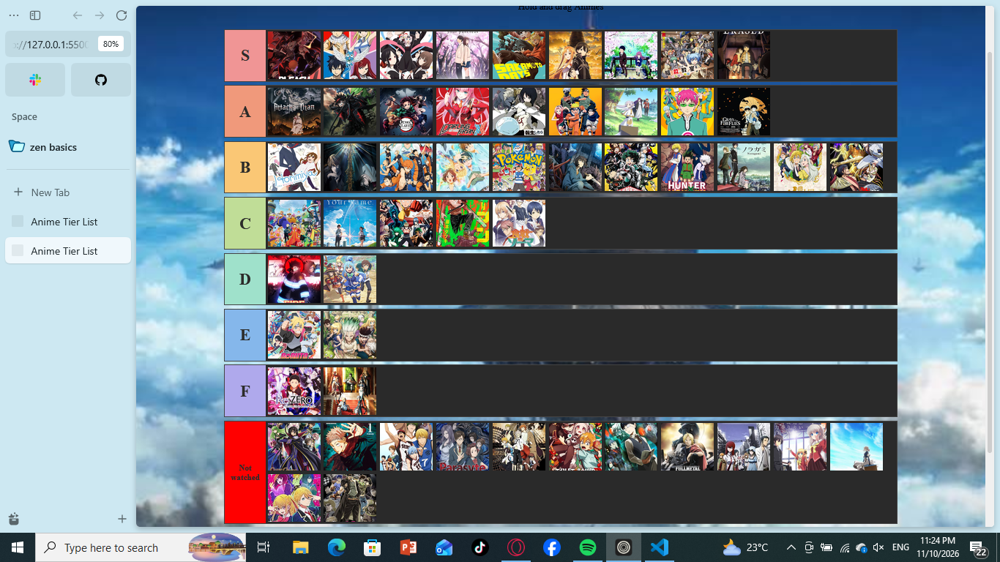

## Anime Tier List

Demo: https://lwhsbg.github.io/Anime-Tier-List/

## What It Is

It is a site that I made where there is a tier list where you can put different animes given in it according to your tastes.

## How to run it

It is very easy, just right click to drag an anime in the anime pool to your preferred class, and just put in the not watched class if you havent watched it at all.

## Animes in the anime pool:

There are 54 animes that I have put up in the pool:

Attack on Titan, Bleach, Boruto, Black Clover, Code Geass, Darling in the Franxx, Death Note, Demon Slayer, Fire Force, Fairy Tail, Haikyu!!, Horimiya, Jujutsu Kaisen, Kuroko’s Basketball, Your Lie in April, Love Is War, Your Name, Naruto, One Piece, I Want to Eat Your Pancreas, Parasyte: The Maxim, Pokémon, Sakamoto Days, Sword Art Online, That Time I Got Reincarnated as a Slime, Solo Leveling, Bungo Stray Dogs, Toilet-Bound Hanako-kun, A Silent Voice, One Punch Man, Tokyo Ghoul, My Hero Academia, Frieren: Beyond Journey’s End, Assassination Classroom, Chainsaw Man, Fullmetal Alchemist, Food Wars!, Hunter x Hunter, Noragami, The Disastrous Life of Saiki K., Steins;Gate, The Seven Deadly Sins, KonoSuba, Charlotte, Dr. Stone, Erased, Grave of the Fireflies, Re:Zero, Violet Evergarden, The Rising of the Shield Hero, Oshi no Ko, Record of Ragnarok, JoJo’s Bizarre Adventure

## Why I Made It

I was scrolling through reddit when I found one of these and I was like oh, i can make this too, then took inspiration and made one.

## How I Made It

It is just simple HTML, CSS and a little bit of javascript for the dragging mechanics.

## What I Struggled With and What I Learnt

I was confused with how to make sections and color them specifically so had to figure that out by researching and also I had some help in the javascript as it is a very hard language for me. Putting it together was really fun.

## Extra Notes:

I would appreciate if you sent your tier list to my slack id, prastut.

## Snapshot of My Tier List

